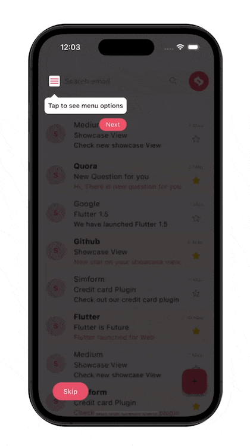

# ShowCaseView

[](https://github.com/SimformSolutionsPvtLtd/showcaseview/actions) [](https://pub.dev/packages/showcaseview)
[](https://github.com/Solido/awesome-flutter#ui-helpers)

A Flutter package that allows you to showcase/highlight your widgets step by step, providing 
interactive tutorials for your application's UI.

_Check out other amazing open-source [Flutter libraries](https://simform-flutter-packages.web.app) and [Mobile libraries](https://github.com/SimformSolutionsPvtLtd/Awesome-Mobile-Libraries) developed by Simform Solutions!_

## Preview
_**For live web demo, visit [ShowcaseView Web Example](https://simformsolutionspvtltd.github.io/showcaseview/)**_



## Features

- Guide users through your app by highlighting specific widgets step by step.
- Customize tooltips with titles, descriptions, actions, and styling.
- Handles scrolling the widget into view for showcasing.
- Support for custom tooltip widgets.
- Animation and transition effects for tooltip.
- Options to showcase multiple widgets at the same time.

## Performance Gains on v5.x.x

Version 5.0.0+ delivers exceptional performance improvements that make ShowcaseView faster and 
more efficient than ever:


> *Performance metrics based on internal benchmarking tests performed on a mid-tier android device.*

### 🚀 **Memory Reduction**
- **Optimized memory usage**: Reduced from **1.8 MB to 0.6 MB**
- Significantly reduced memory footprint for better app performance

### ⚡ **Faster Refresh** 
- **Smoother animations**: Average FPS increased from **58 to 88 FPS**
- Better performance on lower-end devices and complex UI layouts

### 🎯 **Quicker Rendering**
- **Lightning-fast startup**: Initial render time reduced from **68ms to 24ms**
- Dramatically improved time-to-interactive for showcases

## Documentation

Visit our [documentation](https://simform-flutter-packages.web.app/showCaseView) site for all 
implementation details, usage instructions, code examples, and advanced features.

## Installation

```yaml
dependencies:
  showcaseview: <latest-version>
```

## AI Agent Skills

This package ships [agent skills](https://dart.dev/tools/pub/package-skills) for coding agents
(Claude Code, Cursor, Copilot, Codex, …):

| Skill                      | Use it to                                                                          |
|----------------------------|------------------------------------------------------------------------------------|
| `showcaseview-guided-tour` | Build and customize a step-by-step feature tour with `ShowcaseView` and `Showcase` |
| `showcaseview-migration`   | Upgrade your app from its current `showcaseview` version to the latest             |

Install them from your app's root (needs Dart 3.10 or later):

```bash
dart run skills@ get
```

Only packages that are direct dependencies of your app are scanned. Run the command again after
upgrading `showcaseview` to update the skills.

Upgrading from an older version? Upgrade first (`flutter pub upgrade --major-versions showcaseview`),
run the command above, then ask your agent to migrate the project.

> **On Flutter below 3.10 (Dart below 3.10):** `dart run skills@ get` requires Dart 3.10 or later.
> Upgrade Flutter first, or copy the `skills/` directory from this repository manually into your
> app's project root and add it to your `.claude/skills/` folder.

## Support

For questions, issues, or feature requests, [create an issue](https://github.com/SimformSolutionsPvtLtd/showcaseview/issues) on GitHub or reach out via the GitHub Discussions tab. We're happy to help and encourage community contributions.
To contribute documentation updates specifically, please make changes to the doc/documentation.md file and submit a pull request.

## Main Contributors

|  |  |  | 
|:------------------------------------------------------------------:|:------------------------------------------------------------------:|:------------------------------------------------------------------:|
|           [Vatsal Tanna](https://github.com/vatsaltanna)           |           [Sahil Totala](https://github.com/Flamingloon)           |         [Aditya Chavda](https://github.com/aditya-chavda)          |

|  |  |  |
|:------------------------------------------------------------------:|:------------------------------------------------------------------:|:------------------------------------------------------------------:|
|       [Sanket Kachchela](https://github.com/SanketKachhela)        |        [Ujas Majithiya](https://github.com/Ujas-Majithiya)         |        [Happy Makadiya](https://github.com/HappyMakadiyaS)         |

## License

This project is licensed under the MIT License - see the [LICENSE](https://simform-flutter-packages.web.app/showCaseView/license) file for details.
